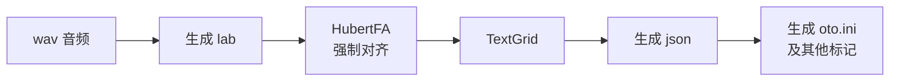

# **TextGrid2oto**

这是一个把 TextGrid / wav 转换为 **oto.ini** 等多种标记的程序，支持 CV、CVVC、VCV、ARPAsing 等录音方案。使用前您需要一定的 UTAU 等引擎的音源制作基础。

当前版本：**GUI v2.3**



## ⚠️ 重要：入口文件说明

| 文件 | 状态 | 说明 |
| --- | --- | --- |
| **`GUI.py`** | ✅ **最新版（推荐）** | wxPython 图形界面，功能最全，持续维护 |
| `legacy/cli/main.py` | ❌ **已废弃** | 旧版命令行（手动输入）脚本，保留仅供参考 |
| `legacy/webui/app.py` | ❌ **已废弃** | 旧版 Gradio WebUI，保留仅供参考 |
| `legacy/webui/WEB-UI.py` | ❌ **已废弃** | 旧版 WebUI 的窗口启动器 |

> 请始终使用 `GUI.py` 作为程序的入口。`legacy/` 下的脚本不再维护，可能缺少新功能甚至无法运行。

## 功能特性

- 根据 wav 文件名（拼音 / 假名）自动生成 `.lab`
- 调用 SOFA / HubertFA ONNX 模型进行强制对齐，生成 TextGrid
- 将 TextGrid 转换为 json 并过滤、整理音素
- 生成多种格式的 `oto.ini`：**CV / CVVC / VCV / ARPAsing**
- oto 参数（左线、固定、右线、预发声、交叉等）可视化调节
- **从 TextGrid 的 phones 层重建 words 层**（调用字典组词，匹配不到的音素按单个音素写入）
- **由 wav + TextGrid 生成 DiffSinger 的 `transcriptions.csv`**（可同时读取 `words / notes / note-slur / ph-num` 附加层）
- **把 `transcriptions.csv` 反推回 TextGrid**（一键还原 `words / phones / notes / note-slur`，并总是写出 `ph-num`）
- **为 `transcriptions.csv` 添加 `ph_num`**（按“元音 + 后续辅音”自动分组）
- **GAME ONNX 推理**：为数据集生成 `note_seq / note_dur / note_slur`（MIDI 标注），长音频自动按词/无声音素分块
- 支持批量处理、录音预设、oto 预设
- 多语言界面（中文 / English / 日本語）

## 目录结构（主要部分）

```
utau自动标注/
├── GUI.py                 # ✅ 最新入口（wxPython GUI）
├── inference/             # 所有推理脚本
│   ├── onnx_infer.py      #   HubertFA ONNX 推理 / 强制对齐
│   ├── tifa_infer.py      #   TIFA ONNX 推理
│   └── game_infer.py      #   GAME ONNX 推理（生成 MIDI 标注）
├── GUI.spec               # Windows 打包配置
├── GUI-macos.spec         # macOS 打包配置
├── build_GUI.bat          # Windows 一键打包脚本
├── GUI.bat                # Windows 启动脚本
├── i18n/                  # 多语言文本（zh / en / ja）
├── img/                   # 图标等资源
├── config/                # 运行预设（语言、oto 预设、CLI 配置示例）
├── lab_generate/          # 生成 lab
├── textgrid2json/         # TextGrid → json、音素检测
├── build_diffdataset/     # words 层重建 + transcriptions.csv ⇄ TextGrid + ph_num
├── json2oto/              # json → oto.ini
├── oto/                   # oto 读取/校验/参数面板
├── presamp/               # 各录音方案的 presamp.ini
├── tg2svdb/               # 转为 svdb 相关
├── dictionary/            # 音素/假名转换表
├── HubertFA_model/        # ONNX 模型（需自行下载，见「环境配置」）
├── TIFA_model/            # TIFA ONNX 模型
├── GAME_model/            # GAME ONNX 模型（生成 note_seq/note_dur/note_slur）
├── HubertFA/ SOFA/        # 模型训练与导出源码
├── tools/                 # 独立小工具（文件名转换、音频拼接等）
├── legacy/                # ❌ 已废弃的旧 CLI / WebUI（可整体删除）
├── archive/               # 历史压缩包（可整体删除）
├── scripts/               # CI / 版本号脚本
└── requirements*.txt      # 依赖清单
```

## 环境配置

推荐使用 **conda** 创建独立环境（Python 建议 **3.12**，本项目在 **Python 3.12.13** 下测试通过）。

### 1. 创建并激活环境

```bash
conda create -n textgrid2oto python=3.12 -y
conda activate textgrid2oto
```

### 2. 安装依赖（GUI.py）

运行最新版 `GUI.py` 只需安装 `requirements-wxui.txt` 即可：

```bash
pip install -r requirements-wxui.txt
```

> 说明：依赖已按平台自动选择 ONNX Runtime 执行后端（需 **Python ≥ 3.11**，推荐 **3.12**）：
> - **Windows** → `onnxruntime-directml`（DirectML GPU 加速，实测比 WebGPU / CPU 更快）
> - **macOS / Linux** → `onnxruntime-webgpu`（DirectML 仅提供 Windows 轮子）
>
> 如需改用 CPU 版，请将这两行替换为 `onnxruntime`。

<sub>旧的已废弃方案对应的依赖（**无需安装**，仅存档参考）：`legacy/webui/requirements-webui-onnx.txt`（ONNX 版 WebUI）、`requirements.txt`（完整依赖，含 torch、训练、Gradio 等，体积较大）。</sub>

### 3. 下载并放置模型

ONNX 模型体积较大，未直接包含在仓库中，请从 Releases 页面下载：

- 📦 **[HubertFA_model 下载（Release v0.1.0）](https://github.com/xiaobaijunya/TextGrid2oto/releases/tag/v0.1.0)**
- 资源文件：`HubertFA_model.zip`（约 244 MB）
  - SHA256：`fde3cd59795754e7e1b2fa5495e40b43fe1efa28e3588765022542abe6ec8eb7`
- 模型源自 [wolfgitpr/HubertFA v0.0.7](https://github.com/wolfgitpr/HubertFA/releases/tag/v0.0.7)，为适配本项目架构做了部分修改。

**放置路径：** 将下载的 `HubertFA_model.zip` 解压，把解压出的 **`HubertFA_model` 整个文件夹放到项目根目录**（与 `GUI.py` 同级），最终结构如下：

```
TextGrid2oto/                    # 项目根目录
├── GUI.py
├── inference/onnx_infer.py
└── HubertFA_model/              # ← 解压到这里
    ├── 1218_hfa_model/
        ├── model.onnx
        ├── vocab.json
        ├── config.json
        ├── zh.txt
        ├── en-arpasing.txt
        └── ja-*.txt
```

**注意事项：**

1. 目录层级必须为 `HubertFA_model/<模型名>/model.onnx`。**不要把 `HubertFA_model` 解压进另一层同名文件夹**（例如出现 `HubertFA_model/HubertFA_model/...` 就是错的）。
2. 每个模型文件夹内必须同时包含 `model.onnx`、`vocab.json` 以及对应语言的字典文件（如 `zh.txt`、`en-arpasing.txt`、`ja-hira-假名.txt` 等）。
3. 在 GUI 中选择模型时，请选择到 **具体的模型文件夹**（例如 `HubertFA_model/1218_hfa_model`），而不是 `HubertFA_model` 这一层。

### 4. 配置参数

旧版命令行参数可参考 `legacy/cli/config.txt`（wav 路径、字典、presamp、忽略音素、录音方案、oto 参数等）；GUI 无需此文件。

## 如何运行

在已激活环境、且位于项目根目录下：

```bash
python GUI.py
```

程序会打开 wxPython 图形界面，按标签页依次操作即可：

1. **生成 lab**：选择 wav 所在文件夹与分隔符
2. **生成 TextGrid**：选择对应 ONNX 模型与字典进行强制对齐
3. **生成 json**：由 TextGrid 转换并过滤音素；字典可从模型文件夹下拉选择（自动填入完整路径），
   也可直接在输入框里手填任意 `.txt` 路径或点「浏览」选择
4. **生成 oto**：选择录音方案（CV / CVVC / VCV / ARPAsing）生成 `oto.ini`
5. **标记生成**：
   - 「OTO生成」：选择音源文件夹与参数生成 `oto.ini`；
   - 「SVDB生成」：选择声库文件夹与字典生成 SVDB 标记；旁边的「生成TextGrid」按钮
     可把 json 反向写成 TextGrid（`words` 层来自 `word_phone.json`；选了字典时
     用词 + 字典 + 音尾比例生成 SV 音素写入 `phones` 层）；
   - 「多音阶OTO」：以子文件夹名作为音阶后缀批量生成；
   - 「transcriptions.csv 制作」子页：
     - 「从 phones 复原 words 层」：选择 TextGrid 文件夹与字典文件，可原地覆盖或输出到新文件夹；
     - 「生成 transcriptions.csv」：选择 wav 文件夹、TextGrid 文件夹与数据集输出文件夹，对应命令
       `python build_dataset.py --wavs ... --tg ... --dataset ...`；音频处理可选「保持原始音频」
       或「量化到 16bit / 44.1kHz / 单声道」；勾选递归子文件夹时，
       样本名会自动加上文件夹前缀（`A4/01.wav` → `A4_01`），避免不同子文件夹同名覆盖；
     - 「添加ph_num」：选择 transcriptions.csv 与两段式字典（或元音/辅音文件），
       自动按“元音 + 后续辅音”生成 `ph_num` 列；     仓库已按语言分好 C+V 集合：`tg2svdb/cv_dicts/<语言>/vowels.txt` 与 `consonants.txt`
     （japanese-romaji / mandarin-xsampa / english-arpabet / cantonese-xsampa / spanish-xsampa），
     也可在「预设字典」下拉框里一键选择；     - 「GAME生成MIDI」：选择 `GAME_model/<模型>` 与 transcriptions.csv，
       为数据集生成 `note_seq / note_dur / note_slur`（无需 PyTorch，仅 ONNX）；
       默认「最大分块」为 30 秒，显存不足时降到 8~16 秒；
     - 「CSV转TextGrid」：选择 `transcriptions.csv`，可选输出文件夹与字典，
       一键反推回 `words / phones / notes / note-slur`。
       选择字典时，`words` 层按「从 phones 复原 words 层」完全相同的规则组词；
       `notes` 尾部会与 `phones` 自动对齐；只要 CSV 里有 `ph_num`，
       就一定同时写出 `ph-num` 层（mark = 该组音素个数）。

> TextGrid 层名：`words` / `phones` / `ph-num` / `notes` / `note-slur`，
> 不含下划线（Praat 会把 `_` 当作下标标记），也不留空格（看不明显），统一用连字符。
> CSV 列名仍按 DiffSinger 规范使用 `ph_num` / `note_slur`。

如需直接使用命令行对齐（调试用）：

```bash
python inference/onnx_infer.py --onnx_path HubertFA_model/1218_hfa_model --wav_folder <wav目录> --language en --dictionary HubertFA_model/1218_hfa_model/en-arpasing.txt
```

## 如何编译（打包）

打包使用 **PyInstaller**，请先在目标环境安装：

```bash
pip install pyinstaller
```

### Windows

方式一：运行一键脚本

```bat
build_GUI.bat
```

方式二：手动执行

```bash
pyinstaller GUI.spec
```

产物输出在 `dist/TextGrid2oto/` 目录，可执行文件为 `dist/TextGrid2oto/TextGrid2oto.exe`。

> `build_GUI.bat` 中写死了 conda 环境的 Python 路径（`F:\ProgramData\anacondacache\envs\test\python.exe`），请按自己的环境修改。

### macOS

```bash
pyinstaller GUI-macos.spec
```

产物输出为 `dist/TextGrid2oto.app`。

> macOS 的 spec 已包含 `presamp`、`tg2svdb/dicts`、`tg2svdb/cv_dicts`、图标等资源（`datas`）。如打包后运行时提示缺少资源文件，请对照 `GUI-macos.spec` 补全 `GUI.spec` 中的 `datas`。

## 注意事项

1. 生成 lab 的时候，请确保您的 wav 名称的 **拼音或假名** 和 **实际音频内容** 可以一一对应。
2. 若使用 scipy ≥ 1.14 并在 PyInstaller 打包后启动报错，请参考用户笔记处理 `scipy/stats/_distn_infrastructure.py` 中 `del obj` 的 `NameError` 问题。
3. 打包后的程序请连同 `dist/` 目录下的全部文件一起分发，不要只拷贝 exe。

## 联系我们

QQ 群聊：**1036935644**

## 相关链接

- [xiaobaijunya/TextGrid-AuditioMarkTools: TextGrid 的 Auditio 标记工具](https://github.com/xiaobaijunya/TextGrid-AuditioMarkTools)
- [wolfgitpr/HubertFA: Hubert-based Forced Aligner](https://github.com/wolfgitpr/HubertFA)
- [praat](https://github.com/praat/praat.github.io)
- [openvpi/DiffSinger](https://github.com/openvpi/DiffSinger)
- [stakira/OpenUtau: Open singing synthesis platform / Open source UTAU successor](https://github.com/stakira/OpenUtau)

## License

本项目采用 [GPL-3.0 license](https://github.com/xiaobaijunya/TextGrid2oto#GPL-3.0-1-ov-file) 开源协议。

> [!NOTE]
> 本 README 内容由 **DeepSeek V4.1 Flash** 生成，**xiaobaijun** 仅进行内容审查和修改，可能内容不完全正确，请以实际代码与程序行为为准。
