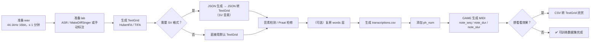

# 制作 AI 数据集：从音频到 `transcriptions.csv`

本文说明如何用 TextGrid2oto 把一批录音整理成 **DiffSinger / 类似歌声合成模型可直接训练的数据集**：
一份 `transcriptions.csv` + `wav`，其中包含音素（`ph_seq` / `ph_num`）与音高（`note_seq` / `note_dur` / `note_slur`）。

---

## 开始之前（务必先看）

### 1. 音频要求

| 项目 | 要求 |
| --- | --- |
| 格式 | `wav` |
| 采样率 / 位深 | **44.1 kHz / 16 bit**（建议单声道） |
| 单条时长 | **不超过 1 分钟** |

> ⚠️ **请务必先把音频切成不超过 1 分钟的小段，再做标注。**
> HubertFA 与 TIFA 在处理超过 1 分钟的音频时都可能出现严重的对齐 bug（时间戳错乱、整段偏移等），
> 提前裁剪要比事后改标记省事得多。可用 Audacity、ffmpeg 等工具批量切分，例如：
>
> ```bash
> ffmpeg -i input.wav -f segment -segment_time 60 -c copy out_%03d.wav
> ```

### 2. lab 文件的来源

数据集的 `lab`（歌词 / 拼音序列）目前**本工具还不能自动生成**，只能依靠：

- **ASR 自动识别**，或
- **手动标注**。

由于本项目的 ASR 功能尚未完成，建议先用社区成熟工具生成 `.lab`：

- 👉 **[openvpi/MakeDiffSinger](https://github.com/openvpi/MakeDiffSinger)** —— DiffSinger 官方的数据集制作流水线，
  包含 ASR 打标、人工校对、音素 / 音高处理等完整流程。
- 推荐配合方式：**先用 MakeDiffSinger 生成 / 校对 `.lab`，再回到本工具生成 TextGrid 与 `transcriptions.csv`**。

### 3. 功能现状

| 功能 | 状态 | 说明 |
| --- | --- | --- |
| 「ASR→TG 标注流程 → ① ASR 识别 / 对齐」 | ❌ 暂不可用 | Qwen3-ASR / ForcedAligner 仍在调试中 |
| 「ASR→TG 标注流程 → ⑤ 音素检测 / 清理」 | ✅ 可用 | 不依赖 ASR |
| 「③ AP 标注」（呼吸检测） | ❌ 暂不可用 | 依赖 FoxBreatheLabeler 的 ONNX 推理，尚未完成 |

---

## 总流程一览



---

## 步骤 1：生成 TextGrid

打开 **「2.TextGrid推理」**，有两个引擎可选：

| 引擎 | 特点 | 何时用 |
| --- | --- | --- |
| **HubertFA 推理** | 稳定，支持自动补 SP/AP（勾选「自动添加 AP/SP 等标签」） | 默认首选 |
| **TIFA 推理** | 音素边界更准（正确率更高） | 追求更高质量，或对 HFA 结果不满意时 |

注意事项：

- **单条音频不要超过 1 分钟**（见「开始之前」）：超长音频会让 HFA / TIFA 出现严重对齐 bug，请先裁剪。
- 需要先在 `HubertFA_model/` / `TIFA_model/` 里放好权重（见各目录的 `README.md`）。
- 模型请选到**具体模型文件夹**（如 `HubertFA_model/1218_hfa_model`），不要选上层目录。
- 选对**字典**（中文 `zh.txt`、英文 `en-arpasing.txt`、日文 `ja-hira-假名.txt` / `ja-romaji-罗马音.txt` 等），字典决定了 TextGrid 里写出的音素体系。
- 若使用 `.lab` 作为输入，请确保 lab 内容与所选字典的语言、音素写法一致。

### TIFA 的已知限制

1. **不会凭自己产生 AP（呼吸）标签**，只会按输入的 lab 产出标记。若需要带 AP 的 TIFA 结果，可以这样做：
   1. 先用 **HubertFA 推理**，并勾选「自动添加 AP/SP 等标签」，得到含 AP 的 TextGrid；
   2. 用 **「其他 → 从tg的words层生成lab」** 把这份 TextGrid 反推成 `.lab`；
   3. 把这个 lab 交给 **TIFA 推理**，TIFA 就会生成出带 AP 的 TextGrid。

   另一条路是 **「③ AP 标注」**（基于 FoxBreatheLabeler 模型），但其 **ONNX 推理尚未完成，目前不可用**。
2. **音频不能太长**：超过 1 分钟的音频可能出现严重对齐 bug，请先裁剪。
3. **不自行生成 `.lab`**：lab 需要事先准备（见「开始之前 → lab 文件的来源」），AP 也是靠 lab 带进来的。

> 多数纯音素 / 音高数据集不含 AP 也能训练，可以先跳过；确实需要时再按上面的 HFA → lab → TIFA 流程补上。

---

## 步骤 2（可选）：JSON 生成

**「4.JSON生成」**：把 TextGrid 的 `phones` 层转成 json，并按忽略音素等规则过滤整理。
后续的「SVDB 生成」「OTO 生成」等功能都依赖这一步产出的 json。

---

## 步骤 3（可选）：json 转成 SV 格式的 TextGrid

如果目标不是 SV（Synthesizer V）数据集，**可以跳过这一步，直接使用步骤 1 得到的 TextGrid**。

需要 SV 音素时：

1. **「5.标记生成 → SVDB生成」**：选择声库文件夹 + 字典 + 音尾比例，点「生成json标记」，得到 `json/word_phone.json` 与 `ds_phone.json`；
2. 再点旁边的 **「生成TextGrid」**，把 json 反写成 TextGrid（words 层来自 `word_phone.json`，phones 层是按字典 + 音尾比例生成的 SV 音素）。

这样得到的就是 **SV 音素体系** 的 TextGrid，可直接用于后续 CSV 的 `ph_seq` 来源（但仍推荐再走一遍音素检测）。

---

## 步骤 4：音素检测与人工检修

### 4.1 先自动检测 / 剔除问题音频

两个入口，检测逻辑相同，按习惯选择：

- **「3.音素检测」**：选择 TextGrid 文件夹，设定阈值（ms），可勾选「忽略首尾SP」「忽略 SP/AP/EP/R 的时长」等，列出所有过短音素；
- **「ASR→TG 标注流程 → ⑤ 音素检测 / 清理」**：检测能力相同，但额外提供**批量清理**：按结果直接删除（或移动）有问题的音频与标注，省去逐个改标记的麻烦。

发现的问题音频可以直接剔除，不必每条都手工修补。

### 4.2 再用 Praat 人工检修

用 Praat 打开 TextGrid，逐句检查：

- 音素边界是否落在波形上；
- 是否有明显的多标 / 漏标；
- `words` 层与 `phones` 层是否对得上。

这一步是**可选**的：TIFA 的正确率已经很高，自动检测剔除后如果只剩少量瑕疵，直接在 Praat 里改更快；但标注质量直接决定训练效果，关键样本仍值得花时间过一遍。

---

## 步骤 5（可选）：复原 words 层

**「5.标记生成 → transcriptions.csv制作 → 从phones复原words层」**：
按字典把 `phones` 层重新拼回 `words` 层。

一般**无需操作**：只有改动过音素、或 words 层缺失 / 损坏时才需要。后续流程其实用不到 words 层，它基本只是方便人工阅读（纯装饰），跳过也没有影响。

---

## 步骤 6：生成 `transcriptions.csv`

**「5.标记生成 → transcriptions.csv制作 → 生成transcriptions.csv」**

| 参数 | 说明 |
| --- | --- |
| WAV 文件夹 | 音频目录 |
| TextGrid 文件夹 | **可留空**：留空时读取每个 wav 同目录的同名 TextGrid |
| 数据集输出文件夹 | 输出位置 |
| 音频处理 | 「保持原始音频」或「量化到 16bit / 44.1kHz / 单声道」 |
| 读取 TextGrid 附加层 | 有 `words` 层则生成 `ph_num`/`word_seq`；有 `notes` 层生成 `note_seq`/`note_dur`；有 `note_slur` 层生成 `note_slur` |
| 递归子文件夹 | 多音阶目录（如 `A4/01.wav`）时勾选，样本名会自动加前缀 `A4_01`，避免同名覆盖 |

此时 CSV 里已有 **`ph_seq`（音素序列）**，但还缺 **`ph_num`（每个词含几个音素）**。

---

## 步骤 7：添加 `ph_num`

**「5.标记生成 → transcriptions.csv制作 → 添加ph_num」**

- 选择 CSV，以及 **C+V 字典**（vowels / consonants）或两段式字典；
- 程序按「元音 + 其后的辅音」规则自动分组，生成 `ph_num` 列。

**关于字典：**

- 安装包内置的**预设字典只有 SV（Synthesizer V）音素体系**，位于 `tg2svdb/cv_dicts/<语言>/vowels.txt` 与 `consonants.txt`：
  `japanese-romaji` / `mandarin-xsampa` / `english-arpabet` / `cantonese-xsampa` / `spanish-xsampa`；
- 如果你用的是 **DiffSinger 的音素体系**（或其他自定义体系），预设字典通常对不上，**需要自己写一份 `vowels.txt` / `consonants.txt`**（或两段式字典）——可以照着已有文件的格式改，先拿一小批音频试跑验证分组是否正确。

---

## 步骤 8：GAME 生成 MIDI（音高标注）

**「5.标记生成 → transcriptions.csv制作 → GAME生成MIDI」**

- 选择 `GAME_model/GAME-1.0.3-small-onnx` 或 `GAME-1.0.3-medium-onnx`；
- **建议用 `small` 模型**，速度明显更快，质量对数据集够用；
- **把「并行数」开大**（CPU 推荐 2~4；GPU 建议 2~3，显存约为单实例的 N 倍）——并行越高整体越快；
- 显存不足时先降低「最大分块(s)」（medium 30 秒峰值约 4.4GB，可降到 8~16 秒）；
- 输出 `note_seq` / `note_dur`，勾选「启用词-音符对齐」还会生成 `note_slur`。

完成后，`transcriptions.csv` 就同时具备：

- **`ph_seq` + `ph_num`** → 可训练音素模型
- **`note_seq` + `note_dur`（+ `note_slur`）** → 可训练音高模型

至此**可训练数据集制作完成** ✅

---

## 步骤 9（可选）：从 CSV 反推 TextGrid「欣赏成果」

**「5.标记生成 → transcriptions.csv制作 → CSV转TextGrid」**：
把 `transcriptions.csv` 反推成 TextGrid（`words` / `phones` / `ph-num` / `notes` / `note-slur`），
用 Praat 打开即可直观看到最终的音素切分与音符排布，用于抽查数据集质量。

- 可选输出目录，留空则写到 CSV 同目录；
- 选择字典时才会生成 `words` 层（按「从phones复原words层」相同的规则组词）；
- 只要 CSV 里有 `ph_num`，就一定写出 `ph-num` 层。

---

## 常见问题

| 现象 | 原因 / 处理 |
| --- | --- |
| 找不到模型 | 模型权重需自行下载，放到 `HubertFA_model/`、`TIFA_model/`、`GAME_model/` 对应子目录（见各目录 README） |
| 预设字典下拉是空的 | 安装包需包含 `tg2svdb/cv_dicts/`；旧版本安装包可能缺少该目录，可自行拷贝 |
| `ph_num` 分组全是 1 | 字典的元音/辅音表与音素体系不匹配（如用 SV 字典处理 DiffSinger 音素），需自建字典 |
| GAME 很慢 | 换 `small` 模型、提高并行数、减小最大分块 |
| TIFA 没有 AP 标签 | TIFA 只按 lab 产出标记：先用 HFA 推理（勾选自动添加 AP/SP）→ 从 tg 生成 lab → 再把 lab 交给 TIFA |
| ASR 相关功能报错 | ASR 目前暂不可用，请改用 HFA / TIFA 流程 |
| 对齐结果整体偏移 / 错乱 | 音频可能超过 1 分钟，先裁剪成 ≤ 1 分钟的小段再推理 |
| 没有 lab 文件 | 本工具暂不能生成 lab，建议用 [MakeDiffSinger](https://github.com/openvpi/MakeDiffSinger) 做 ASR 打标或手动标注 |
